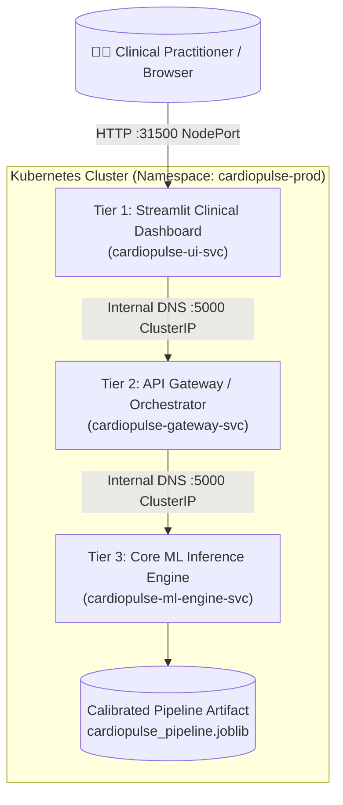

# 🫀 CardioPulse-K8s
> **Cloud-Native Microservices Architecture for Cardiovascular Risk Assessment**

[](https://kubernetes.io/)
[](https://www.docker.com/)
[](https://streamlit.io/)
[](https://scikit-learn.org/)
[](LICENSE)

---

## 📌 Executive Summary
**CardioPulse-K8s** is an enterprise-grade, cloud-native machine learning system designed for real-time cardiovascular patient triage and clinical risk stratification. Built upon a decoupled **3-Tier Microservices Architecture** deployed on **Kubernetes**, the platform provides:

1. **Calibrated Machine Learning**: Random Forest ensemble equipped with probability calibration (`CalibratedClassifierCV`) achieving **0.9491 ROC-AUC** and **86.89% accuracy** on the Cleveland Heart Disease benchmark.
2. **Strict Medical Data Isolation**: The Core ML Inference Engine operates in a private, unexposed `ClusterIP` network zone. Only the API Gateway communicates with it via Kubernetes Internal DNS (`cardiopulse-ml-engine-svc:5000`).
3. **Interactive Clinical Decision Support Dashboard**: Modern Streamlit frontend supporting single patient triage, dynamic risk gauge meters, batch cohort CSV evaluation, and live cluster health diagnostics.

---

## 🏛️ System Architecture



---

## 📊 Dataset & Model Metrics

- **Dataset**: UCI Cleveland Heart Disease Dataset (303 patient records, 13 clinical biomarkers).
- **Features Handled**:
  - Continuous: `age`, `trestbps` (resting blood pressure), `chol` (serum cholesterol), `thalach` (max heart rate), `oldpeak` (ST depression).
  - Categorical: `sex`, `cp` (chest pain type), `fbs` (fasting blood sugar), `restecg`, `exang`, `slope`, `ca`, `thal`.

| Metric | Score | Note |
| :--- | :--- | :--- |
| **ROC-AUC** | **0.9491** | Excellent discriminatory ability between high and low risk |
| **Accuracy** | **86.89%** | Evaluated on held-out 20% test partition |
| **F1-Score** | **0.8621** | Harmonic mean of precision and recall |

---

## 🚀 Quickstart Guide

### 1. Clone the Repository
```bash
git clone https://github.com/JayKalbi/CardioPulse-K8s.git
cd CardioPulse-K8s
```

### 2. Train the Pipeline Locally (Optional)
```bash
python data/download_data.py
python model-training/train_pipeline.py
```

### 3. Build & Load Container Images
```powershell
# Build Docker Images
docker build -t cardiopulse-ml-engine:v1 ./services/ml-inference-engine
docker build -t cardiopulse-gateway:v1 ./services/api-gateway
docker build -t cardiopulse-ui:v1 ./services/streamlit-ui

# Load into Minikube cluster
minikube image load cardiopulse-ml-engine:v1
minikube image load cardiopulse-gateway:v1
minikube image load cardiopulse-ui:v1
```

### 4. Deploy to Kubernetes
```powershell
kubectl apply -f k8s/01-namespace.yaml
kubectl apply -f k8s/02-configmap.yaml
kubectl apply -f k8s/03-ml-inference-deployment.yaml
kubectl apply -f k8s/04-api-gateway-deployment.yaml
kubectl apply -f k8s/05-streamlit-deployment.yaml
```

### 5. Access the Platform
```powershell
minikube service cardiopulse-ui-svc -n cardiopulse-prod
```
The browser will open displaying the interactive CardioPulse Clinical Dashboard!

---

## 🛡️ Microservices Justification & Viva Questions

- **Why separate the Gateway from the ML Engine?**  
  *Separation of concerns.* In clinical production environments, input validation, request throttling, authentication, and compliance logging should not consume model computing resources. The ML Inference Engine remains stateless, thread-safe, and private.
- **Why use ClusterIP for Tier 2 & Tier 3?**  
  *Zero-Trust Security.* Medical AI services must never be exposed publicly. They can only be reached by authorized internal services via Kubernetes internal DNS.
- **How does Horizontal Pod Autoscaling (HPA) work?**  
  When incoming triage requests or batch CSV processing cause CPU utilization on `cardiopulse-ml-engine` to exceed 70%, Kubernetes spins up additional inference pods automatically to distribute the load.

---

## 📜 License
Distributed under the MIT License. See `LICENSE` for more information.
